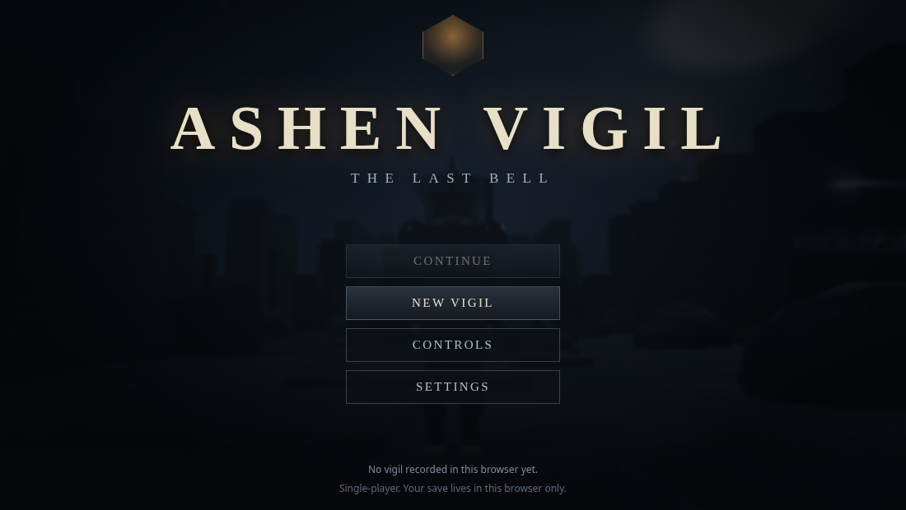
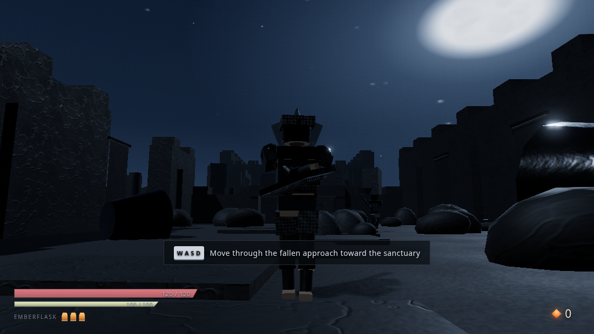
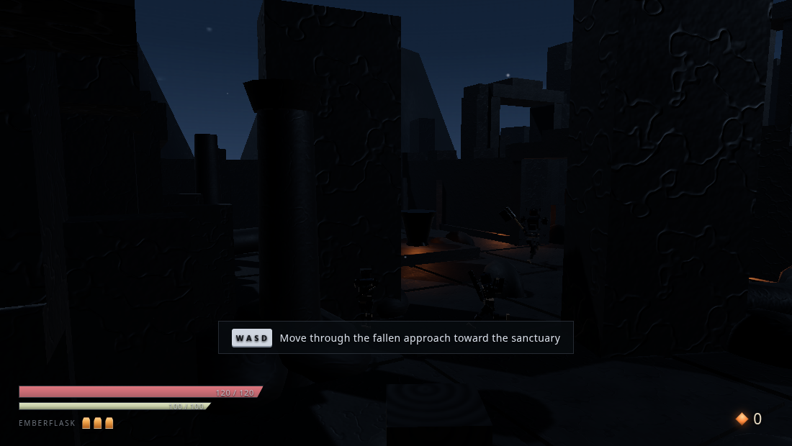
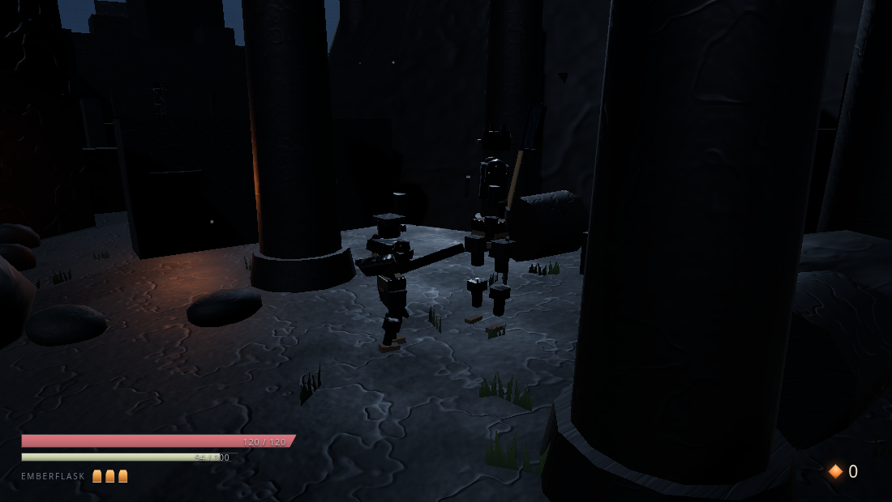
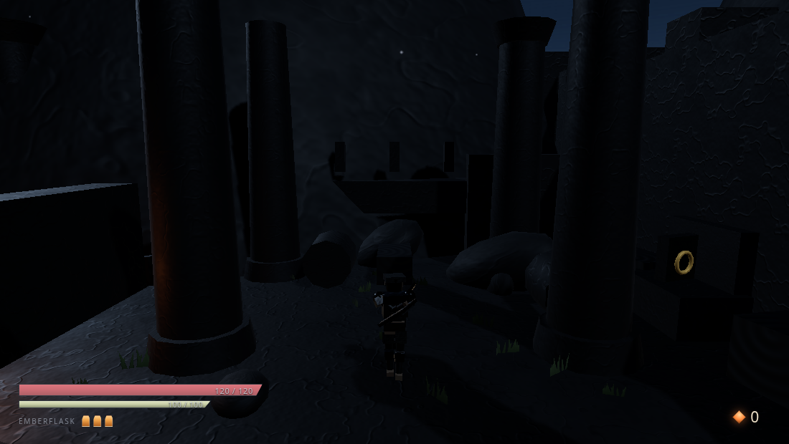
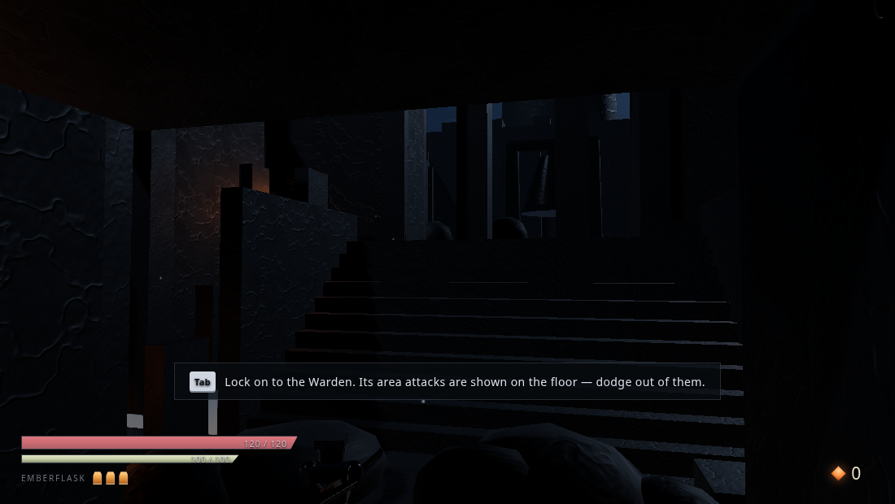
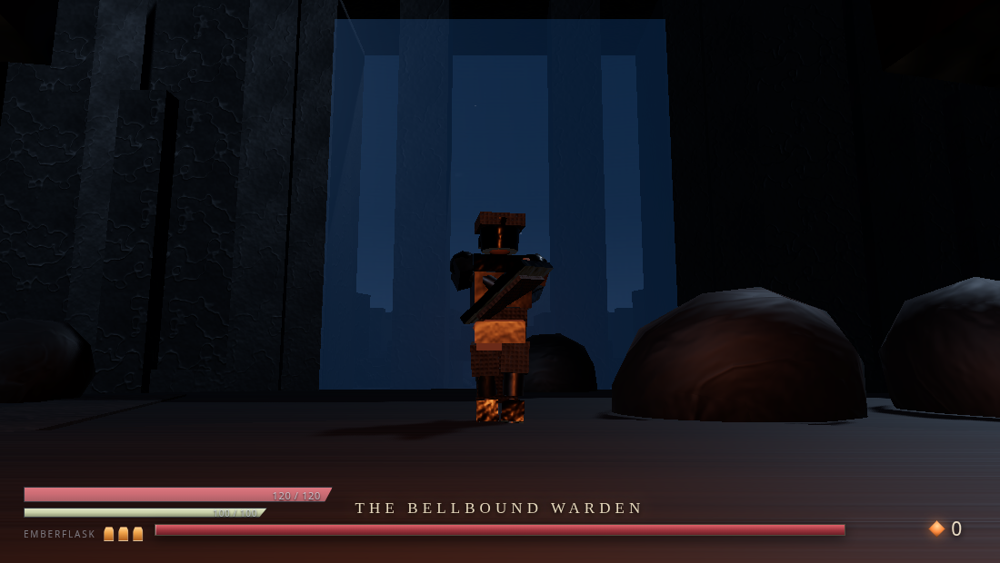
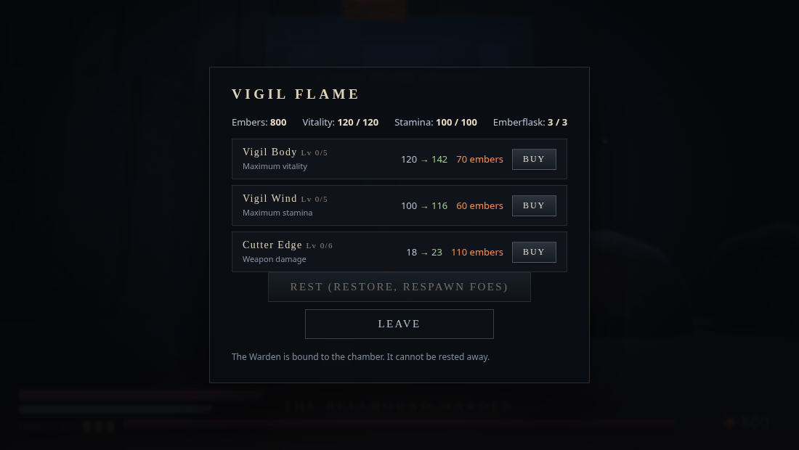

# ASHEN VIGIL: THE LAST BELL

A third-person soulslike action game that runs entirely in the browser. No backend, no API
keys, no hotlinked assets — the whole game is a static build you can serve from any file host.

You are the last vigil-keeper of a ruined sanctuary. The bells have gone cold, the dead walk
the cloister, and something the size of a chapel waits in the chamber below, welded into the
largest bell ever cast. Carry embers back to the Vigil Flames, get strong enough, ring the
last bell.

**Playtime:** 15–30 minutes for a first playthrough. **One save slot**, stored in the browser.










---

## 1. Playing it

### From the shipped build

```bash
cd ashen-vigil
npx vite preview            # serves dist/ at http://localhost:4173
```

Or serve `dist/` with anything static:

```bash
python3 -m http.server -d dist 8080
```

`dist/` is self-contained (5.0 MB total). It needs a **WebGL2** browser — Chrome, Edge,
Firefox, or Safari 15+. If WebGL2 is missing the game shows a readable message instead of a
black screen.

### Shareable archive

`ashen-vigil-1.0.0.zip` (4.85 MB, 71 files) contains the source, tests, tools, the built
`dist/`, the screenshots, the test report, `README.md` and `LICENSES.md`. It contains **no
`node_modules`**, no backend, no API keys and no hotlinked assets: the `dist/` inside it is the
game, and the smoke test was re-run from an extracted copy of that archive (67/67).

```bash
npm run package      # rebuilds the archive from the current tree
```

### Live build

The game is hosted as a static site on Render: **https://ashen-vigil.onrender.com**
(no server, no keys — the page is the whole game). See `render.yaml` for the service
definition; `npm ci && npm run build` produces `dist/`, which is what gets published.

### From source

```bash
npm ci
npm run dev          # vite dev server
npm run build        # typecheck + production build into dist/
```

---

## 2. Controls

| Action | Key |
| --- | --- |
| Move | `W` `A` `S` `D` |
| Camera | Mouse (Pointer Lock) |
| Light attack (3-hit combo) | Left Mouse |
| Guard | Right Mouse (hold) |
| Heavy attack | `Q` |
| Dodge | `Space` |
| Sprint | `Shift` |
| Heal (Emberflask) | `R` |
| Interact / rest / open gate | `E` |
| Lock-on | `Tab` |
| Cycle lock targets | `F` `G` / mouse wheel |
| Pause, release mouse | `Esc` |
| Controls overlay | `H` |

Movement is **camera-relative**. Lock-on keeps the camera on a target and soft-aims attacks at
it. `Esc` releases the mouse and opens the pause menu; menus freeze combat input and clear
held keys, so nothing "sticks" when you tab away.

### Combat rules

- **Stamina** gates everything: light 12, heavy 30, dodge 20, guard drains while held. It
  regenerates only when you are not attacking, guarding, dodging or staggering.
- **Guard** absorbs damage from the front but drains stamina per hit; empty stamina = **guard
  break**, a long vulnerability window.
- **Poise**: enough damage in a window staggers an enemy out of its attack. Heavy hits and
  backstabs stagger harder.
- **One hit per swing per target**, enforced by a hit registry that samples the actual blade
  (tip *and* mid-shaft, swept between physics steps) — no tick-cheating by waving the sword,
  no double-hitting the same enemy.
- Attacks cannot be restarted mid-windup, so mashing does not make you faster; follow-ups are
  accepted from the active/recovery phase or from the input buffer when the swing ends.
- Death drops every ember at the spot you died. Reach them and you get them all back; die
  again before that and the old pile is gone.

---

## 3. The world

One interconnected level, no loading screens inside it:

```
The Fallen Gate (arrival)
   └─ The Fallen Approach ── Vigil Flame I
        └─ The Sunken Courtyard ── Vigil Flame II ── lever ── shortcut portcullis
             ├─ The Cloister / balcony / walkway
             ├─ The West Corridor (opened by the portcullis)
             ├─ The Bell Stair (down)
                  └─ The Bell Chamber ── THE BELLBOUND WARDEN
                       └─ The Last Bell
```

- **One shortcut gate.** The portcullis at the courtyard's west wall is locked from this side.
  Pull the lever in the courtyard, it lifts, the corridor opens, and the shortcut stays open
  forever (it is part of the save).
- **Two Vigil Flames** (checkpoints). Resting restores vitals, respawns ordinary enemies, and
  opens the upgrade shop. The boss and the bell are not reset by resting.
- **Three enemy types**: Hollow Sentry (fast sword), Ashbound Brute (slow, heavy, high poise),
  Bell Acolyte (ranged ember bolt, keeps its distance).
- **Two-phase boss.** The Bellbound Warden gets faster and gains a telegraphed area slam and a
  bell-toll wave below 40% health. Arena barriers go up when the fight starts and come down
  when it ends.
- **Ending:** defeat the Warden, then interact with the last bell. The ending is recorded in
  the save and the title screen remembers it.

---

## 4. Architecture

```
src/
  bootstrap/Game.ts     orchestrator: fixed-step order, screens, saves, glue
  config/               Balance.ts (every tunable number), Quality.ts (presets)
  core/                 pure logic, no three.js, no DOM — unit tested
    Stamina.ts Damage.ts HitRegistry.ts Drops.ts Progression.ts SaveFormat.ts
    MathX.ts Events.ts Types.ts
  physics/Physics.ts    Rapier wrapper: layers, character controllers, probes
  render/               Textures, Materials, GeometryUtils, HumanoidRig, Animators, Graphics
  world/                LevelData (descriptors) → LevelBuilder (meshes + colliders),
                        Navigation (validated graph), WorldObjects (flames, gate, pickups)
  input/  camera/  entities/  combat/  fx/  audio/  systems/Saves.ts  ui/UI.ts
tests/                  vitest unit tests for the pure core
tools/smoke.mjs         Playwright end-to-end smoke test against the built game
tools/shots.mjs         screenshot harness used for the art pass
```

### The two rules everything else follows from

**1. Rapier is the only authority on where things are.** Every actor is a kinematic character
body driven by a `KinematicCharacterController`. Rendering reads the physics position and
never writes it. Hit queries read the *rendered* blade, so the game snaps actor roots to the
authoritative position before evaluating a swing — a hit can never be judged against a stale
pose.

**2. Simulation runs on a fixed step; rendering does not.** `SIM.fixedDt = 1/60`, an
accumulator with a clamp and a substep cap. Visual transforms are interpolated between steps.
Quality settings change pixels, never timing: at 5 fps and at 144 fps the combat, AI, damage
and collision are identical. The smoke test asserts this ("frame timing is frame-rate
independent").

Level visuals and level colliders are generated from the **same descriptors**
(`LevelData.ts`), so a wall you can see is a wall you can hit. Decorative props carry no
collider unless they are meant to block.

### Navigation

The AI walks a graph of 52 nodes / 163 directed links. Every edge is validated against real
collision before it is accepted: the builder probes the ground under the segment, rejects
excessive slope, and walks three parallel corridor probes so a narrow pillar cannot falsely
reject a doorway. Edges that fail validation are dropped and reported
(`NavigationGraph.droppedLog`); the smoke test asserts zero dropped edges and full
reachability. Opening the portcullis steps physics and rebuilds the graph, so the AI can use
the shortcut immediately.

The traversal claim is not just a graph claim: the smoke test drives the **real player**
(real input, real capsule, real character controller) from the arrival gate to the bell
chamber and asserts it arrives without getting stuck.

### Saves

- Key `ashen_vigil_save`, `version: 3`, JSON.
- Validated on load: future versions are rejected rather than guessed, malformed/empty JSON is
  rejected, partial saves are filled with defaults, hostile values are clamped, and
  `checkpointId` is checked against the level's real respawn ids (`spawn` plus both flames).
- Stores: vitals/embers/upgrades, checkpoint, gate state, pickups, lore, boss and bell state,
  deaths, playtime, quality and control settings, and the ember drop (position + amount).
- Export/import JSON from the settings panel.

### Rendering

- three.js r186, `MeshStandardMaterial`, procedural PMREM environment from a procedural night
  sky (the same texture drives the visible background and the reflections).
- Everything is procedural: stone/wood/metal/cloth texture sets, the sky, the moon, grass
  tufts, the humanoid rigs, and all audio (WebAudio synthesis — no sample files).
- Four presets (Low / Medium / High / Ultra) plus Custom: render scale 50–100%, shadow
  quality, bloom, SMAA/FXAA/MSAA, adaptive resolution, decoration density, LOD distances,
  particle budget, point-light pool size.
- A single pooled set of point lights serves flames, embers and the Warden; the shadow frustum
  follows the viewer and snaps to the texel grid to stop shimmer.

---

## 5. Testing

```bash
npm run typecheck      # tsc --noEmit, strict
npm test               # vitest: 59 unit tests over the pure core
npm run build          # typecheck + vite build
npm run test:smoke     # Playwright against dist/: 68 checks
```

Unit tests cover the parts that are pure logic: stamina accounting, damage/guard/poise
resolution, the hit registry (one hit per swing, re-arm on a new swing), ember drop/recovery
rules, progression costs and clamps, and save validation/migration.

The smoke test boots the **production build** in headless Chromium and drives it through:
boot, new game, navigation, traversal, movement, camera-relative controls, mouse look, collision,
combat (light/heavy/guard/guard break/dodge/heal/enemy aggression), death and ember recovery, checkpoints, upgrades, the
shortcut gate, the full boss fight (both phases, telegraphs, barrier, reward), the bell and
the ending, save/reload/continue, save edge cases, all four quality presets, the pause /
controls / settings overlays, and console cleanliness.

Latest run: **68/68 checks passed**, 59/59 unit tests, no uncaught runtime errors.
Full transcript: `reports/smoke.md` (machine-readable: `reports/smoke.json`).

### How the end-to-end checks stay honest

Headless runs are slow (≈1 fps under SwiftShader), so a check that depends on live frames
being in the right place at the right moment fails for reasons that have nothing to do with
the game. The combat, death and recovery checks therefore drive the game through
`Game.fixedUpdatePublic(dt, keys)`, which feeds scripted input into the **real fixed step**:
same physics, same animation timing, same hit resolution, no dependence on how fast the page
renders. Where a check needs a fixed geometry ("my sword connects"), the guardian is pinned
and the player is placed by hand; where a check needs the world to behave (the traversal run,
the boss fight), nothing is pinned and the actor walks under its own AI and physics.

Headless Chromium reports `movementX = 0` for real pointer-lock moves, so the mouse-look check
feeds a synthetic pointer-lock `mousemove` through the real document listener and lets live
render frames consume it. Without that check the look path can go dead silently.

Two test-only switches exist so that incidental events cannot decide a result:
`Game.testDisableVoidDeath` (a scripted exchange that walks off an edge is not a death) and
the scripted input map in `Input`. Neither changes balance, timing or collision for a player.

### Performance numbers — read this before judging them

The smoke test runs in **headless Chromium with SwiftShader** (software WebGL, no GPU).
Absolute frame rates there are meaningless for real hardware:

| Preset | FPS (SwiftShader) | Draw calls | Triangles | Render target |
| --- | --- | --- | --- | --- |
| Low | 1.1 | 481 | 44,160 | 896×503 |
| Medium | 1.7 | 496 | 44,175 | 1088×612 |
| High | 2.5 | 498 | 44,177 | 1280×720 |
| Ultra | 0.6 | 537 | 45,045 | 1280×720 |

What the run *does* establish: every preset renders, the render target actually follows the
preset, the frame counter advances, and simulation time advances correctly regardless of how
few frames are drawn. On a real GPU the same build is expected to run at 60 fps at 1080p on
Medium/High; that has **not** been measured on hardware here, and is stated as an expectation,
not a result.

---

## 6. Known limitations

- **Bundle size.** `dist/assets/physics-*.js` is ~4.3 MB because Rapier's WASM is inlined as
  base64 by `rapier3d-compat`. It is one download, cached forever, and it means the game works
  from `file://`-ish static hosts with no fetch of a `.wasm`. Total build: 5.0 MB.
- **Draw calls sit around 480–540.** Fine for a desktop GPU, but a mobile GPU would want the
  decoration sets merged further. Low/Medium already reduce decoration density and LOD range.
- **No gamepad support.** Keyboard + mouse only.
- **No touch controls.** The layout is responsive down to small windows, but the game assumes
  a mouse and keyboard.
- **Single save slot** per browser profile, no cloud, no accounts. Clearing site data deletes
  the save; export/import is provided in settings.
- **Audio is procedural.** It is generated with WebAudio, so it is thin compared with sampled
  music. It starts only after a user gesture, per browser autoplay policy.
- **No localisation.** English text only.
- **Fall death is a safety net, not a designed mechanic.** Falling below `WORLD.voidY` kills
  you where you stand rather than animating a fall.
- **Accessibility is partial.** Reduced-motion and shake sliders, damage-number toggle, and
  readable menus exist; there is no remappable key list and no colour-blind mode.

---

## 7. Licences

Game code and all generated assets: see `LICENSES.md`. Bundled runtime dependencies are
`three@0.186.1` (MIT) and `@dimforge/rapier3d-compat@0.21.0` (Apache-2.0). Every texture,
mesh, animation and sound in the build is generated procedurally by this codebase — there are
no third-party art or audio files.
